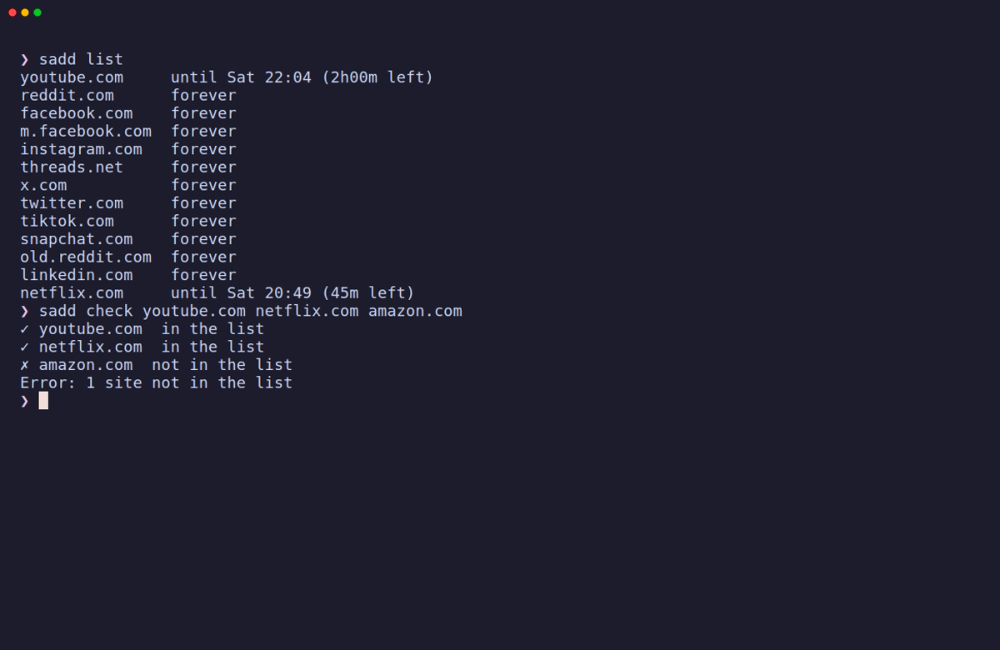
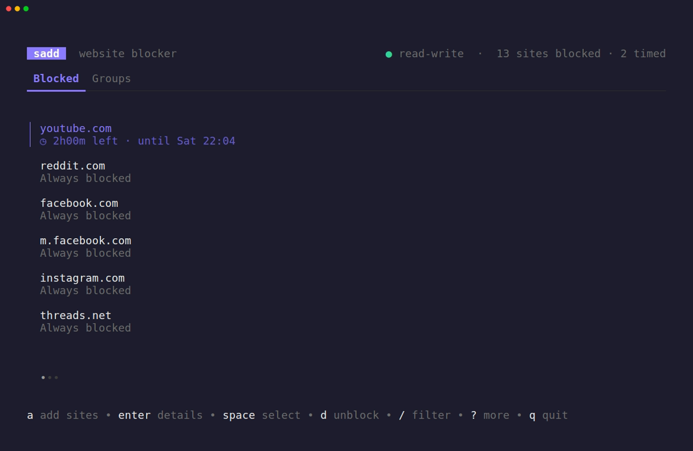
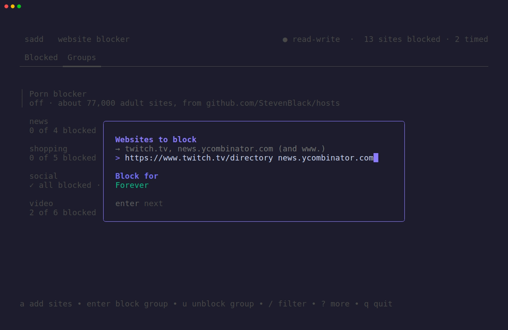
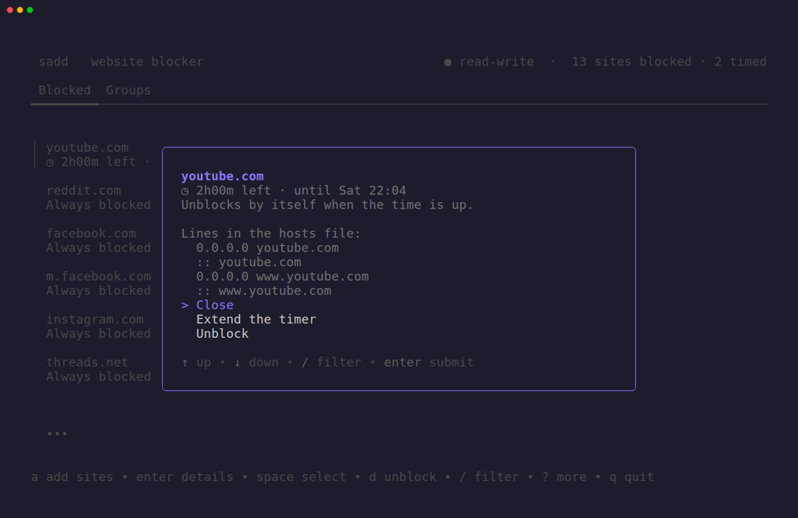
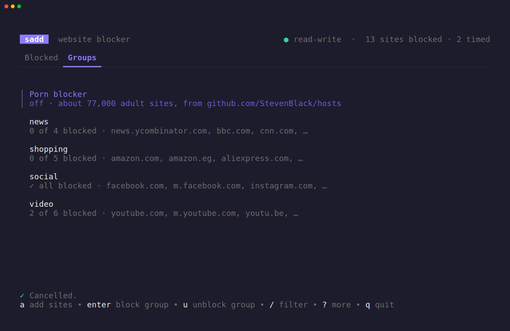

# sadd

**sadd** blocks distracting websites on Linux. It manages its own small
section of `/etc/hosts`, so there is no daemon, no browser extension and no
database. Block a site forever or for a while, block a whole group
(social, video, news…), or turn on a ready-made porn blocker. You can do
all of this from the command line or from the interactive screen.


## Install

### Ubuntu / Debian (recommended)

Download the `.deb` from the
[latest release](https://github.com/mahm0udnasr/sadd/releases/latest) and
install it with `apt`. Pick `amd64` for most PCs and laptops, or `arm64` for
ARM machines such as a Raspberry Pi.

```bash
wget https://github.com/mahm0udnasr/sadd/releases/download/v1.1.0/sadd_1.1.0_amd64.deb
sudo apt install ./sadd_1.1.0_amd64.deb
```

The package:

- installs `sadd` to `/usr/bin`
- enables `sadd-expire.service`, which cleans up timed blocks at boot
- adds **sadd** to your app menu. It opens in a terminal and asks for your
  password.

Check it worked:

```bash
sadd --version
```

You can check the download against `checksums-deb.txt` from the same release:

```bash
sha256sum -c checksums-deb.txt --ignore-missing
```

**Upgrading:** install the new `.deb` the same way. Your blocked sites stay
where they are.

**Removing:** `sudo apt remove sadd`. Your blocked sites stay in `/etc/hosts`,
so unblock them first if you want them gone (see [Uninstall](#uninstall)).

> Installed with `make install` before? Run `sudo make uninstall` from the
> source folder first, so you don't end up with two copies.

### With Go

```bash
go install github.com/mahm0udnasr/sadd@latest
```

This only installs the binary. Timed blocks still work, but the boot cleanup
service is not installed. Use the `.deb` or build from source for that.

### From source

Needs Go 1.27 or newer.

```bash
git clone https://github.com/mahm0udnasr/sadd.git
cd sadd
make                 # build as your normal user
sudo make install    # copies to /usr/local/bin and enables the boot service
```

## Quick start

```bash
sudo sadd block youtube.com --for 2h     # block for two hours
sudo sadd block --group social           # block every social site, forever
sadd list                                # what's blocked, and for how long
sadd check youtube.com                   # is it really blocked?
sudo sadd unblock youtube.com            # changed your mind
sudo sadd                                # interactive screen
```

You can paste full URLs. `https://www.YouTube.com/watch?v=…` becomes
`youtube.com`.

## Screenshots

**Command line:** `sadd list` and `sadd check`



**Interactive screen:** run `sudo sadd`. Timed blocks show how much time is left.



| Add sites (live preview of what will be blocked) | Site details (`enter`) |
|---|---|
|  |  |

**Groups tab:** block or unblock a whole group, or turn on the porn blocker.



## Interactive screen

Run `sudo sadd` (or `sudo sadd tui`). Without sudo it opens read-only.

| Key | Action |
|---|---|
| `tab` / `1` `2` | Switch between **Blocked** and **Groups** |
| `↑` `↓` / `j` `k` | Move |
| `/` | Filter |
| `a` | Add sites (choose a duration, or **Custom…** like `45m`, `1h30m`, `2d`) |
| `enter` | Details of a site (Blocked tab) · block a group (Groups tab) |
| `space` | Select several sites (`ctrl+a` selects all) |
| `d` | Unblock the selected sites, or the one under the cursor |
| `e` | Add time to a timed block |
| `u` | Unblock a group (Groups tab) |
| `z` | Undo the last change |
| `?` | Show all keys |
| `q` | Quit |

## Commands

| Command | What it does |
|---|---|
| `sudo sadd block <domain>...` | Block one or more sites |
| `sudo sadd block <domain> --for 2h` | Block for a while (`30m`, `1h30m`, `1d`; minimum `1m`) |
| `sudo sadd block --group social` | Block a built-in group (`-g` for short, can be repeated) |
| `sudo sadd unblock <domain>...` | Unblock sites (also takes `--group`) |
| `sadd list` | Show what is blocked and for how long (no sudo needed) |
| `sadd groups` | Show the built-in groups: `social`, `video`, `news`, `shopping` |
| `sudo sadd restore` | Undo the last change (run it again to redo) |
| `sadd blocklist` | Show the blocklists and whether they are on |
| `sudo sadd blocklist on porn` | Download the porn list and turn it on (or cancel turning it off) |
| `sudo sadd blocklist off porn` | Turn it off after a 10-minute cooldown |
| `sudo sadd blocklist update` | Download the newest version of the lists that are on |
| `sadd check [domain]...` | Ask the system what a site resolves to; exit code 1 if any is not blocked |
| `sudo sadd` | Interactive screen (same as `sadd tui`) |

Each domain is blocked for IPv4 and IPv6, with and without `www.`:

```
0.0.0.0 youtube.com
:: youtube.com
0.0.0.0 www.youtube.com
:: www.youtube.com
```

> **Subdomains are not blocked automatically.** `/etc/hosts` has no
> wildcards, so blocking `youtube.com` does not block `m.youtube.com`.
> Block it explicitly, or use a group, which already includes common ones.

### Porn blocker

`sudo sadd blocklist on porn` downloads the
[StevenBlack](https://github.com/StevenBlack/hosts) porn-only list (about
77,000 sites) into its own section of `/etc/hosts`. Turning it on is instant.
Turning it **off takes 10 minutes**, and running `on` during that time
cancels it, so you have a moment to change your mind. In the interactive
screen it is the first row on the Groups tab.

## A blocked site still loads?

1. Run `sadd check example.com`.
   - **✗ not blocked:** it isn't in the list. Run `sudo sadd block example.com`.
   - **✗ in sadd's list, but…:** something before sadd wins. Look for an
     earlier line for the same name in `/etc/hosts`, and make sure the `hosts:`
     line in `/etc/nsswitch.conf` contains `files`.
   - **✓ blocked:** the system is fine. The browser is the problem (step 2).
2. Close the browser completely (every window) and open it again. Or clear
   its cache: `chrome://net-internals/#dns` → *Clear host cache*, then
   `#sockets` → *Flush socket pools* (Chrome, Brave, Edge), or
   `about:networking#dns` → *Clear DNS Cache* (Firefox).
3. Turn off *Secure DNS* / *DNS over HTTPS* in the browser settings.

## How it works

sadd keeps everything between two markers in `/etc/hosts`:

```
127.0.0.1 localhost          ← your lines: never modified
# >>> sadd start
# until 2026-11-10T23:15:00+02:00 youtube.com
0.0.0.0 youtube.com
:: youtube.com
0.0.0.0 www.youtube.com
:: www.youtube.com
# <<< sadd end
```

- **No database.** The hosts file is the only source of truth. A timed
  block's end time is stored as a comment inside the sadd section.
- **Timed blocks** create a systemd transient timer that runs `sadd expire`.
  It doesn't unblock a specific site: it removes only entries whose end time
  has passed. So if you change your mind and block a site forever, the
  pending timer leaves it alone. At boot, `sadd-expire.service` removes blocks
  that ended while the computer was off and re-creates timers for the rest.
- **Blocklists** get their own section (`# >>> sadd blocklist porn` …
  `# <<< sadd blocklist porn`), so they show as one item, not 77,000. The
  download is never copied as-is: a hosts file can *redirect* a name, not
  just block it, so sadd keeps only the domain names, checks each one, and
  writes the `0.0.0.0` / `::` lines itself.
- **Atomic writes.** sadd writes to a temp file in `/etc`, calls `fsync`, then
  `rename`s it over `/etc/hosts`. The file is never half-written, and its
  permissions and owner are kept.
- **Backup.** Before each change, the current file is copied to `/etc/hosts.bak`.
  `sadd restore` swaps the two files.
- **Refuses damaged files.** If the markers are broken (for example a start
  without an end), sadd stops with an error instead of guessing.
- **DNS flush.** After every change sadd runs `resolvectl flush-caches`.

## Limitations

- **Linux with systemd only.** It's built and tested on Ubuntu, and uses
  `systemd-resolved` to flush the DNS cache.
- **Browser caches.** A browser that already has the site open keeps its
  connections, and browsers keep their own DNS cache. Some use DNS-over-HTTPS,
  which ignores `/etc/hosts`. See [A blocked site still loads?](#a-blocked-site-still-loads)
- **Willpower not included.** Anyone with sudo can undo a block. sadd is a
  speed bump, not a lock.

## Uninstall

```bash
sudo sadd unblock $(sadd list | awk '{print $1}')   # optional: remove your blocks first
sudo sadd blocklist off porn                          # if you turned it on

sudo apt remove sadd       # if you installed the .deb
sudo make uninstall        # if you installed from source
```

## Development

### Testing without touching /etc/hosts

Point sadd at any file with `HOSTS_FILE`. No sudo is needed for a file you own:

```bash
cp /etc/hosts /tmp/hosts
HOSTS_FILE=/tmp/hosts ./sadd block youtube.com
HOSTS_FILE=/tmp/hosts ./sadd
```

`sudo` drops environment variables. If you really need both, write
`sudo HOSTS_FILE=/tmp/hosts sadd ...`.

Run the test suite with:

```bash
make test
```

### Recording the demo and screenshots

The GIF and screenshots are made with [VHS](https://github.com/charmbracelet/vhs)
from the tapes in `docs/tapes/`. They use a throwaway hosts file, so recording
changes nothing on your system and needs no password.

```bash
make
vhs docs/tapes/demo.tape          # → docs/images/demo.gif
vhs docs/tapes/screenshots.tape   # → docs/images/*.png
rm docs/tapes/screenshots.gif     # VHS needs an output; only the PNGs are kept
```

If VHS fails with "could not start browser", run it with `VHS_NO_SANDBOX=true`.

### Project layout

```
cmd/                 Cobra commands (CLI only: parse input, print output)
internal/hosts/      parse, render and atomically write the hosts file
internal/groups/     built-in site groups
internal/blocklist/  downloaded blocklists (porn)
internal/timer/      durations and systemd timers
internal/dns/        DNS cache flush and system lookups (getent)
internal/tui/        Bubble Tea interface
packaging/           systemd unit installed by "make install"
docs/tapes/          VHS scripts for the demo GIF and screenshots
docs/images/         the GIF and screenshots used in this README
testdata/            sample hosts file for tests
```

## License

[MIT](LICENSE)
